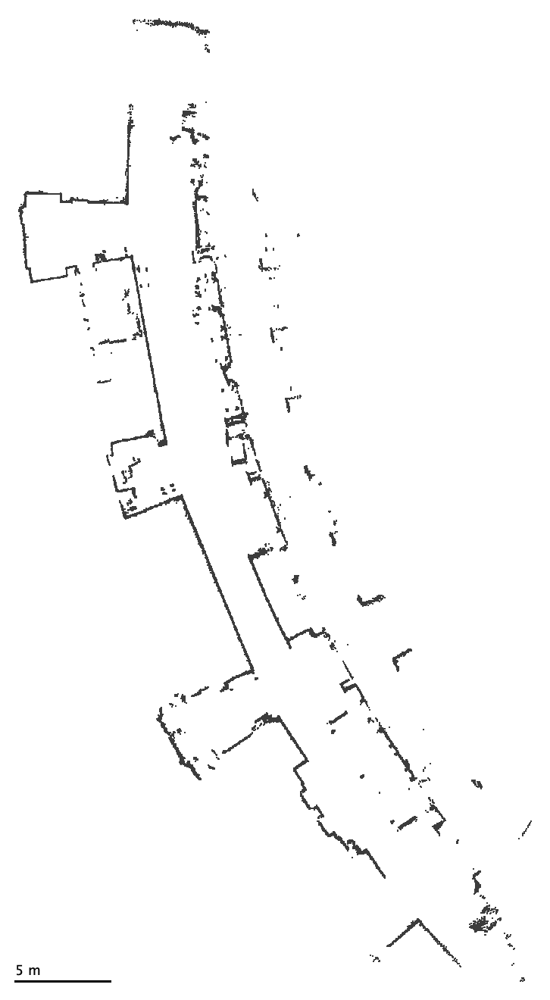
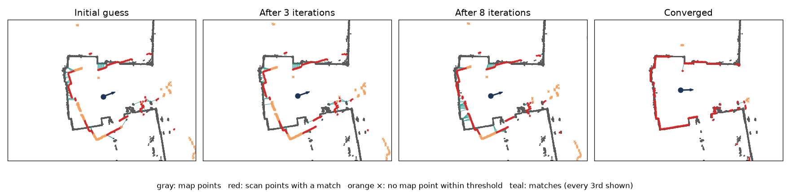
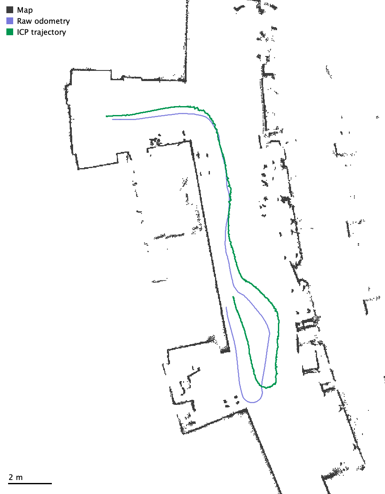

> ***AI Use Acknowledgment:***
> 
> I have been thinking of having a class on this topic for a while.  I used AI for initial language for today and also to create and run the evaluation of a k-d tree on the robot scan data.  I went back and forth several times on the details of the particular exercises.
{: .notice--warning}

Today, we will see an algorithm called Iterative Closest Point (ICP), which pairs really nicely with KD-Trees.  I hope that seeing an application of KD-trees will make the case that they are very powerful!

## Robot Localization

Picture a mobile robot driving around the first floor of the MAC. It carries a LiDAR: a spinning laser rangefinder that measures the distance to the nearest obstacle at 720 angles around the robot (one reading every half degree), several times per second. Each set of 720 readings is called a scan. Given the angle and distance reading from each measurement (distance and angle), convert the reading into an $(x, y)$ point to get a 2D outline of the walls, furniture, and people around the robot.

We also have a map of the building, built from earlier lidar scans. We store the map as a 2D point cloud: a list of $(x, y)$ points marking where objects are in the environment (these could be walls, people, furniture).

Here's the map we'll use: the first floor of the MAC, with 16,871 points spaced 3 cm apart.

The robot is capable of coarsely estimating its own motion as it moves through the world (odometry).  This estimate is based on computing how far the wheels have turned and fusing that with inertial measurements (angular velocity and acceleration) to come up with a rough **guess** of its pose consisting of its position $(x, y)$ and heading $\theta$ in the map.  This calculation is subject to error, so the guess drifts further from the truth as the robot drives. Our job is to fix the guess by lining up what the lidar sees with the map.

## The Iterative Closest Point (ICP) Algorithm

> **Iterative closest point (ICP)** for one scan.
>
> Inputs: the map points, the scan end points (in the robot's frame), a guess of the robot's pose, and a match distance threshold $d_{\max}$.
>
> 1. **Project** every scan end point into the map frame using the current pose guess (rotate by $\theta$, then shift by $(x, y)$).
> 2. **Match** each projected point to its *nearest neighbor* among the map points. If that neighbor is farther away than $d_{\max}$, throw the match away; the point probably hit something that isn't in the map (a person, a moved chair), or our guess is still too far off.
> 3. **Re-estimate** the pose: find the rotation and translation that best lines up the matched pairs and apply it to the pose guess.
> 4. **Iterate** steps 1 to 3 until the pose stops changing (convergence).
>
> For the next scan, start from the pose we just found, moved by however much odometry says the robot moved since then.
{: .notice--warning}

Here's ICP on a real scan from our data set. We started from a guess that's 0.7 m and 20° off, and each iteration pulls the scan (red) closer to the map (gray).

### The re-estimation step

Step 3 has a nice closed form in 2D. Suppose we have matched pairs $(a_i, b_i)$ for $i = 1, \ldots, N$, where $a_i$ is a projected scan point and $b_i$ is the map point it matched. We want the rotation angle $\phi$ and translation $t$ that minimize

$$\sum_{i=1}^{N} \left\| R(\phi)\, a_i + t - b_i \right\|^2.$$

You might think you'd have to run some sort of gradient descent algorithm to figure out this solution.  It turns out you can compute the answer by performing a singular value decomposition (SVD).  If you want to read more about this, you can look up the [Kabsch algorithm](https://en.wikipedia.org/wiki/Kabsch_algorithm) in two dimensions. There is also a [detailed (and highly mathy) tutorial](https://igl.ethz.ch/projects/ARAP/svd_rot.pdf) on the connection available from ETH Zurich.

### ICP by hand

> **Exercise 1**
>
> Show that you understand ICP by running one iteration by hand on a chalkboard with the people around you. Use two colors if you can: one for the truth and one for the guess.
>
> 1. **Map.** Sketch a coarse map: a few walls, such as an L-shaped hallway or a room with a doorway. Put dots every so often along the wall. These dots are your map point cloud.
> 2. **True pose and scan.** Pick where the robot *really* is and draw it as a circle with an arrow for its heading. Draw 8 to 10 laser beams from the robot to the walls, and mark where each one hits. These hit points are the scan end points. What the robot actually records is each beam's distance and angle *relative to itself*.
> 3. **Initial guess and projected scan.** Draw a guessed pose that's a bit off from the true one: shifted a little and rotated by maybe 10 to 20 degrees. Now project the scan: from the guessed pose, redraw each beam with the *same* distance and the *same* angle relative to the robot's heading, and mark the end points. You should get the same shape as the true scan, but moved and turned so it no longer lines up with the walls.
> 4. **Match.** Pick a threshold $d_{\max}$. For each projected end point, draw an arrow to its nearest map dot. Cross out any arrow longer than $d_{\max}$.
> 5. **Re-estimate.** Decide roughly how to shift and rotate the whole projected scan, as one rigid shape, so the remaining arrows get shorter overall. (Hint: if you only shift without rotating, the best shift is the average of the arrows.) Apply the same shift and rotation to the guessed pose, then redraw the pose and the projected scan.
> 6. **Check.** Is the new projected scan closer to the map than before? Redo the matching: do any end points now match a *different* map dot than in step 4? What would the next iteration do?
> 7. **Break it.** Can you choose an initial guess for which ICP pulls the scan into the *wrong* place? What features of the map make that more or less likely?
{: .notice--success}


Things to look for in your sketch:

* **The scan keeps its shape.** Projecting just rotates and shifts the scan as a rigid whole. If your projected scan is stretched or distorted, recheck step 3: each beam keeps its length and its angle relative to the robot.
* **The arrows point roughly the same way.** If the guess is shifted, most arrows point in the direction the scan needs to move. If it's rotated, arrows on opposite sides of the robot point in roughly opposite directions around it. The re-estimation step finds the single rigid motion that best agrees with all of the arrows at once.
* **One iteration helps, but it usually doesn't finish the job.** Nearest-neighbor matches made from a wrong pose are only partly right: an end point that belongs on the far wall may be matched to a closer wall instead. After the update the scan sits closer to the map, so the new matches are more accurate, and the next iteration moves it closer still. That's why ICP *iterates*.
* **Crossed-out arrows.** Points with no map dot within $d_{\max}$ have no say in the update. On the real robot these are usually beams that hit people or furniture that aren't in the map. In your sketch they might be end points that landed in a doorway or in empty space.
* **Ways to break it.** A long, featureless hallway: sliding the scan along the hallway doesn't change any of the distances, so ICP can't tell where along the hallway the robot is. A big initial rotation or shift: end points get matched to the wrong wall, and ICP can settle confidently into the wrong pose (a *local minimum*). A symmetric room: several poses fit equally well. Corners, doorways, and other distinctive features make ICP more reliable, and so does a good initial guess from odometry.



## Estimating Computational Efficiency

> **Exercise 2**
>
> Suppose the map has $n$ points, each scan has $m$ end points, and ICP takes $I$ iterations to converge.
>
> 1. If we find each nearest neighbor by brute force (checking every map point), what is the time complexity of one ICP iteration? Of processing one scan?
> 2. Plug in numbers from our data: $n \approx 17{,}000$ map points, $m \approx 550$ valid end points per scan, $I \approx 17$ iterations per scan, and 716 scans in a 93 second drive. About how many distance computations is that in total? If a computer does roughly a billion of them per second, can we keep up with the robot in real time?
> 3. Compare the cost of step 2 (matching) with steps 1 and 3 (projecting and re-estimating). Which one dominates?
{: .notice--success}


1. Each of the $m$ scan points is compared with all $n$ map points, so one iteration is $\Theta(nm)$ and one scan is $\Theta(nmI)$.
2. $17{,}000 \times 550 \times 17 \approx 1.6 \times 10^8$ distance computations per scan, or about $1.1 \times 10^{11}$ (110 billion) for the whole drive. At $10^9$ per second that's about 2 minutes of computing for 93 seconds of driving, so we can't keep up. (Our reference implementation measured 121 billion distance computations and 1 minute 34 seconds.)
3. Projecting and re-estimating are $\Theta(m)$ per iteration, so matching completely dominates as it is $\Theta(nm)$.



## Speeding Things Up with a K-d Tree

Last class we built k-d trees for fast nearest neighbor search. Matching is exactly a pile of nearest neighbor queries, in 2 dimensions, which is where k-d trees shine. Throughout this page, a **query** means matching one scan end point to the map: finding the map point closest to that end point, or reporting no match if nothing is within $d_{\max}$.

> **Exercise 3**
>
> Work out how to use a k-d tree to speed up ICP. Sketch the plan with the people around you before looking at any code.
>
> 1. Which set of points should go into the tree: the map points or the scan points? Why?
> 2. When do you build the tree? Once overall, once per scan, or once per ICP iteration?
> 3. What is the new time complexity for one ICP iteration? How much does building the tree cost, and how often do you pay that cost?  Note: for simplicity, you can assume that you do not need to visit any alternative branches when backtracking.
> 4. Estimate the speedup for our data set.
{: .notice--success}


1. **The map.** The map points never move; the scan points move every time the pose estimate changes. Each query is "which map point is closest to this scan point?", so the tree holds the map and the scan points are the queries.
2. **Once overall.** A tree built on the scan points would have to be rebuilt every iteration, and we'd still need to answer queries about map points.
3. Building costs $\Theta(n \log n)$ (median splits), paid once. Each query takes about $\Theta(\log n)$ on average for well-spread 2D data, so an iteration costs about $\Theta(m \log n)$ instead of $\Theta(mn)$.
4. $\log_2 17{,}000 \approx 14$, versus 17,000 comparisons per query for brute force. A query visits a few more nodes than the tree's depth because it sometimes has to backtrack, so expect hundreds of times fewer distance computations. In our reference implementation a query computes about 25 distances on average, roughly **650 times fewer** than brute force.



> **Exercise 4**
>
> ICP throws away any match farther than $d_{\max}$ (we use 0.3 m). How can a k-d tree search use this threshold to do even *less* work than a normal nearest neighbor search? Think about the pruning test from Exercise 5 last class.
{: .notice--success}


A normal search needs to check an alternate branch of the tree if it could possibly find a closer match than the closest found so far.  In this alternate formulation, we can avoid searching the additional branch if it's impossible for a point to be within $d_{\max}$ of the query.



> **Exercise 5**
>
> 1. The two scan end points that sit next to each other in a scan (half a degree apart) usually land very close together in the map, and a scan point barely moves between ICP iterations. How could you use these facts to speed up nearest neighbor search even more?
> 2. Here's another approach: precompute, for every cell of a fine grid over the building, which map point is closest (a *distance transform*). What does a query cost now? What are the downsides? When would you choose a k-d tree instead?
{: .notice--success}


1. Use the previous answer as a starting guess: begin the search with the best distance set to the distance to last iteration's match (or the neighboring scan point's match). That makes the pruning radius small from the very first node. Some implementations also cache the leaf they ended at and search outward from there.
2. A query becomes a $\Theta(1)$ array lookup, which is why many real localization systems do this! The downsides are memory (proportional to the area times $1/\text{resolution}^2$, not to the number of points), a fixed resolution, and the whole grid has to be recomputed whenever the map changes. All of this gets much worse in 3D. A k-d tree adapts to wherever the points actually are, handles any resolution, and generalizes to 3D lidar point clouds.



## Interpreting Results from a Reference Implementation

I implemented ICP twice in Kotlin. The two versions are identical except for how they find nearest neighbors: one uses brute force, and the other uses a k-d tree built from the map with median splits. Both run nearest neighbor searches with a starting radius of $d_{\max} = 0.3$ m, as in Exercise 4.

The data comes from the [comprobo23/robot_localization](https://github.com/comprobo23/robot_localization) repository:

* **Map:** `maps/mac_1st_floor_final.yaml`, the occupancy grid shown at the top of this page. Each occupied 3 cm cell becomes one map point, for $n = 16{,}871$ points.
* **Robot data:** `bags/macfirst_floor_take_1`, a recording of a TurtleBot4 robot driving for 93 seconds. It has 716 lidar scans (about 550 valid end points each, one scan every 130 ms) plus wheel odometry.

For each scan, the initial guess is the previous ICP pose moved by however far odometry says the robot traveled.

Localizing all 716 scans on my laptop:

| Method | Total time | Time per scan | Distance computations |
| --- | ---: | ---: | ---: |
| Brute force | 1 min 34 s | 131 ms | 121,081,952,288 |
| k-d tree | 1.5 s | 2.1 ms | 183,605,915 |

Building the k-d tree took 11 ms. ICP took about 17 iterations per scan on average, and the two versions produced exactly the same pose for every scan.

The dashed blue line is the raw odometry and the green line is the ICP trajectory. Odometry drifts up to almost a meter away from the ICP estimate partway through the drive.

> **Exercise 6**
>
> 1. The two versions produced *exactly* the same trajectory, down to the last bit. Should we have expected that? What would it mean if they differed?
> 2. Could each version keep up with the robot in real time? How much spare time does the k-d tree version have per scan?
> 3. The k-d tree does about 650 times fewer distance computations but is only about 60 times faster. Give some reasons why the speedup in time is smaller than the reduction in work.
> 4. Building the tree costs 11 ms. After how many queries has that investment paid for itself? (On this map, one query takes 14.7 µs with brute force and 0.16 µs with the k-d tree.)
{: .notice--success}


1. Yes. A correct k-d tree search returns the true nearest neighbor within $d_{\max}$, just as brute force does, so every match, every pose update, and every iteration is identical. (Ties, two map points at exactly the same distance, could be broken differently, but that is extremely rare with real-valued coordinates.) If the trajectories differed, it would point to a bug in the tree search, most likely a pruning test that skips a subtree it shouldn't.
2. Scans arrive every 130 ms. Brute force needs 131 ms per scan, so it falls slightly behind and gets further behind over time; on a slower robot computer it would be hopeless. The k-d tree needs 2.1 ms, leaving about 128 ms (over 98% of the time) for everything else the robot has to do.
3. Each step of a k-d tree search does more than compute a distance: it makes recursive calls, picks which side to search first, tests whether to prune, and follows pointers to nodes scattered around memory. Brute force runs a tight loop over an array, which the CPU can execute very quickly (it predicts the branches and prefetches the memory). $\Theta()$ ignores these constant factors.
4. Each query saves about $14.7 - 0.16 \approx 14.5$ µs, so the tree pays for itself after about $11{,}000 / 14.5 \approx 760$ queries. That's fewer than two ICP iterations on a single scan (550 queries each), out of more than 12,000 iterations over the drive.



### Which queries are expensive?

Here's how many distance computations each k-d tree query needed over the whole drive (7.2 million queries). A query is *matched* if it found a map point within $d_{\max} = 0.3$ m, and *unmatched* otherwise.

| Queries | Count | Mean | Median | 95th percentile | 99th percentile | Max |
| --- | ---: | ---: | ---: | ---: | ---: | ---: |
| All | 7,176,928 | 25.6 | 23 | 45 | 69 | 128 |
| Matched | 6,380,851 | 23.8 | 22 | 39 | 51 | 128 |
| Unmatched | 796,077 | 39.9 | 39 | 74 | 90 | 99 |

> **Exercise 7**
>
> 1. In the worst case, a k-d tree query can end up checking every point in the tree. How close did we come to that worst case here? Compare the maximum with brute force's 16,871 for every query.
> 2. Unmatched queries do *more* work than matched ones, on average. Explain why. (Think about how the search radius changes during a search in each case.)
> 3. About 11% of queries are unmatched. Where in the building or in the ICP process do you think those queries come from?
{: .notice--success}


1. Not close at all. The very worst query in 7.2 million checked 128 points, less than 1% of the map, and 99% of queries checked 69 or fewer. The worst case requires points arranged so that the pruning test almost never succeeds, and real 2D maps don't look like that.
2. A matched query usually finds a map point a few centimeters away within its first few steps down the tree. From then on the search radius is tiny, so almost every other branch gets pruned. An unmatched query never finds anything closer than $d_{\max}$, so its radius stays at a full 0.3 m for the whole search. A 0.3 m circle overlaps many more cells of the tree's partition than a 3 cm circle, so the search has to check more branches.
3. From laser beams that hit things that aren't in the map (people, chairs, doors that were closed when the map was made), from parts of the building the map doesn't cover well (the map has gaps along some walls), and from early ICP iterations where the pose guess is still off, so some scan points land in empty space.


